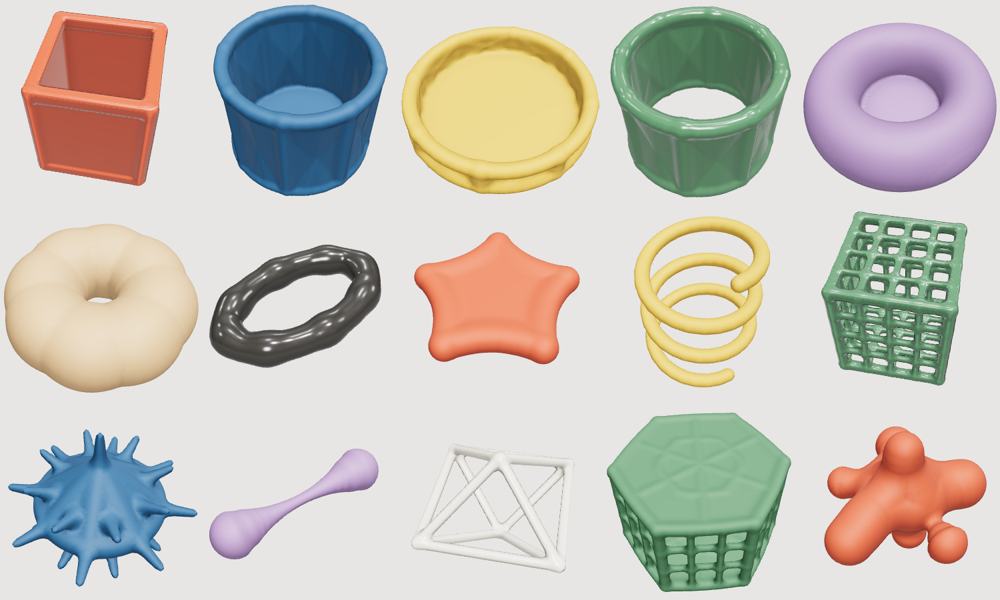

# irorandom

**Procedural objects from a handful of parameters.** Pick a skeleton, give it flesh, add a lattice or some noise — and get a finished, closed mesh in one call. No modelling, no boolean operations, no mesh repair.



- **Skeleton → flesh → lattice → noise.** Shapes are built the way people make things: a frame, material around it, structure, then irregularity. ~30 parameters, each with a visible effect.
- **Always a usable result.** Every parameter combination yields one connected, closed mesh with rounded joints. Random seeds give endless variations.
- **Controllable.** A [parameter spec](spec/parameters.json) written for people *and* language models, plus [recipes](recipes/recipes.json) for common goals (open box, vase, tray, ring, spring, lattice cube…).
- **Zero dependencies.** ~1,300 lines of plain JavaScript. Runs in browsers, Node.js, Deno and Web Workers. Exports STL and OBJ.

## Quick start

```js
import { generate, measure, toSTL } from './index.js';

// An open-top box: a square prism with plates on every face except the top
const mesh = generate({ base: 'prism', sides: 4, height: 1.6, membrane: 1, membraneFaces: 2, radius: 0.04 });

measure(mesh);          // { size: [0.9, 0.74, 0.9], closed: true, holes: 0, ... }
const stl = toSTL(mesh); // ArrayBuffer, longest side 60 mm, ready for a slicer
```

```js
import { generate, random } from './index.js';
const mesh = generate(random(1234)); // the same seed always gives the same shape
```

Write a recipe to an STL file from the command line:

```bash
node examples/stl.mjs vase
```

### With three.js

```js
const g = new THREE.BufferGeometry();
g.setAttribute('position', new THREE.BufferAttribute(mesh.positions, 3));
g.setAttribute('normal', new THREE.BufferAttribute(mesh.normals, 3));
g.setAttribute('color', new THREE.BufferAttribute(mesh.colors, 3)); // baked ambient occlusion
g.setIndex(new THREE.BufferAttribute(mesh.indices, 1));
scene.add(new THREE.Mesh(g, new THREE.MeshStandardMaterial({ color: mesh.color, vertexColors: true })));
```

## API

| function | returns |
|---|---|
| `generate(params, { resolution = 56, colliders = false })` | `{ positions, normals, colors, indices, color, params, colliders? }` — Y up, centred, longest side = `params.size`. `resolution` 104 gives fine detail. `colliders` adds simplified capsules for physics engines. |
| `random(seed)` | a full parameter object |
| `measure(mesh)` | `{ size, volume, parts, closed, nonManifoldEdges, holes, triangles }` — check a result without looking at it |
| `toSTL(mesh, { size = 60 })` | binary STL (`ArrayBuffer`), Z up, standing on z = 0 |
| `toOBJ(mesh, { size = 1 })` | OBJ text with normals |
| `SCHEMA`, `DEFAULTS`, `PALETTE` | the raw parameter definitions |

## Parameters

See **[docs/PARAMETERS.md](docs/PARAMETERS.md)** (or the machine-readable [spec/parameters.json](spec/parameters.json)). In short:

- **skeleton** — `base` (blob, line, arc, helix, loop, prism, pyramid, bipyramid, star), `sides`, `bulge`, `size`, `height`, `depth`
- **flesh** — `radius`, `profile` (round ↔ square), `taper`, `fillet`, `membrane`, `membraneFaces`, `hole`, `holeDepth`
- **network** — `lattice`, `grid`, `struts`, `strutLen`, `knob`, `drop`
- **symmetry** — `sym` (none, mirror, n-fold)
- **noise** — `bend`, `rnoise`, `seed`
- **finish** — `color`, `surface`, `clarity` (for rendering only)

## Using it with an AI assistant

The spec and recipes are meant to be handed to a language model. A workflow that works well:

1. Give the model `spec/parameters.json` and `recipes/recipes.json` (or [`llms.txt`](llms.txt)).
2. Ask for a shape in words ("a shallow hexagonal tray with a lattice rim").
3. Let it pick parameters, call `generate`, check `measure()` (size, holes, closed), and adjust.

In our own test, a model working only from the spec reached 13 of 16 requested shapes. Known limits are listed at the end of the recipes file (no sphere skeleton, no legs, no combining shapes).

## How it works

1. **Skeleton** — the chosen base produces nodes, edges and faces; lattices subdivide faces, struts grow from nodes, symmetry folds everything around the vertical axis.
2. **Flesh** — edges become capsules (round or rounded-square cross-sections), faces become thin plates, blobs become super-ellipsoids. Noise bends lines and varies their thickness.
3. **Field** — all parts are combined into one signed distance field with a smooth union, which gives cast-like fillets at every joint.
4. **Mesh** — Surface Nets turns the field into triangles; normals come from the field gradient and ambient occlusion is baked into vertex colours. Loose fragments are dropped.

## Credits

Concept, design and art direction: **Iromune Goshikizawa** ([@modu1lor](https://github.com/modu1lor)). Implemented in collaboration with [Claude Code](https://claude.com/claude-code) (Anthropic).

Built on well-known public techniques: the polynomial smooth minimum and distance functions popularised by [Inigo Quilez](https://iquilezles.org/articles/), Surface Nets meshing, and the mulberry32 random number generator (public domain).

This library is the shape engine of [Irorandom](https://kaiwa-obje.pages.dev), a small toy box of generated objects.

## License

MIT — see [LICENSE](LICENSE). If you make something with it, a link back is appreciated.
